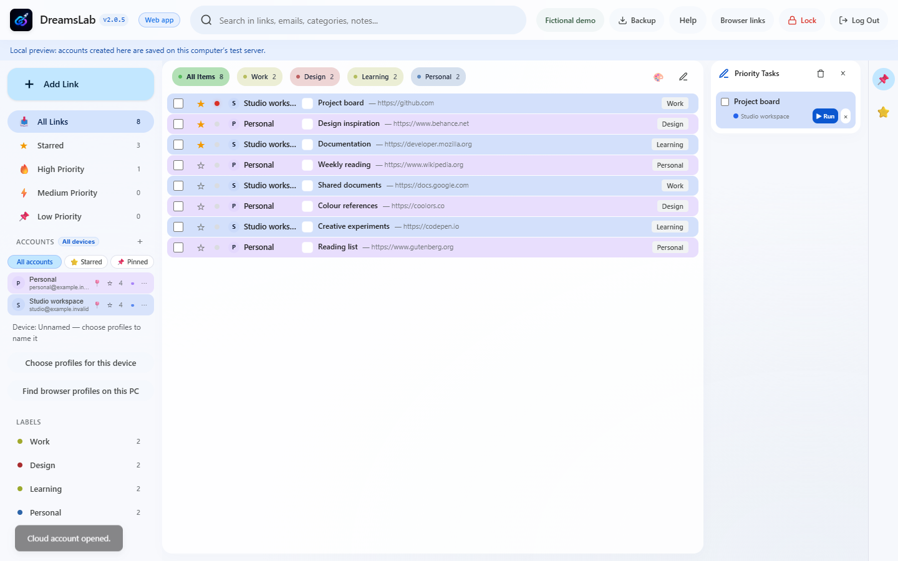

# DreamsLab Link Launcher



**Links, accounts and workspaces in one encrypted library.** Desktop and phone web app with optional Windows Chrome/Edge profile routing.

[Open app](https://link-launcher.ranakaharian1.workers.dev) · [Interactive guide](https://link-launcher.ranakaharian1.workers.dev/guide.html) · [Make it yours](docs/SETUP.md)

## Explore

[Web app & PWA](#web-app--pwa) | [Cloud sync](#cloud-sync) | [Chrome / Edge](#chrome--edge) | [Backups](#backups) | [Own hosting](docs/SETUP.md)

### Web app & PWA

Search links; organise by account, category, priority, stars and labels. Edit, select and reorder. Save workspaces per browser installation. Install with Chrome/Edge **Install app** or phone **Add to Home Screen**. No maintained EXE or store listing is included.

### Cloud sync

Create an empty account with an email identifier and master password of at least 12 characters. Email is not verified Google sign-in. Links are encrypted in your browser before Workers/D1 sync; the server stores email, authentication metadata and encrypted bytes. Choose **Open / create local-only vault** without registration. Previously loaded vaults support offline edits; conflicts preserve local changes for recovery.

### Chrome / Edge

Optional **unpacked Manifest V3 extension**, not a Chrome Web Store listing. In **Browser profiles → Setup**, download, extract permanently, load unpacked in `chrome://extensions` or `edge://extensions`, run `Setup.cmd` and reload. [Full guide](browser-bridge/README.md).

The Windows helper runs per user and may download a checksum-verified official Node runtime. Browser mappings stay on that PC. Websites retain their own cookies; Google sessions are not transferred. Phones open links normally without the helper.

### Backups

Export encrypted `.dlvault` backups before clearing browser data, replacing a vault or moving URLs. Import replaces the selected vault after confirmation. Readable JSON exports contain private data. Lost master passwords cannot be recovered. Remembered unlock is only for trusted private browsers; Lock removes it. Sync is not an independent backup.

## Quick start

Install Node.js 22+, then in this folder:

```sh
npm ci
npm start
```

Open `http://localhost:3000`. Try a fresh local-only vault. No bundled accounts, passwords or owner records are required.

```sh
npm run build
npm test
npm run test:cloudflare:web
```

Browser tests require Chrome and use isolated fictional accounts. Builds publish only allowlisted assets to `web-dist`. API responses are not service-worker cached.

## Make it yours

[GitHub, Cloudflare, alternative Node hosting and extension setup](docs/SETUP.md). Workers/D1 are supported; Supabase is not integrated. You control hosting, backups and billing. Free tiers have limits.

MIT for this open-source personal edition; see [LICENSE](LICENSE). Separately distributed commercial editions are outside this release. Report security issues privately through the owner's GitHub profile; never attach credentials or vaults to issues.

Historical account-data files are excluded from this clean release. Copies or forks made before cleanup cannot be recalled by changing Git history.
